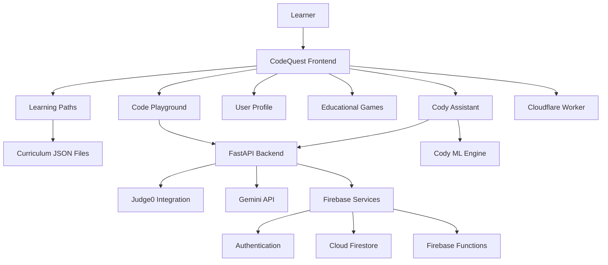

# 🚀 CodeQuest — Cody Academy

<p align="center">
  <strong>An Interactive Programming Learning Platform</strong>
  <br>
  <em>Learn to Code · Practice · Create · Explore</em>
</p>

<p align="center">
  
  
  
  
</p>

<p align="center">
  <a href="https://mariam2009m44-lab.github.io/CodeQuest/dashboard.html">🌐 Live Application</a>
  &nbsp;·&nbsp;
  <a href="https://github.com/mariam2009m44-lab/CodeQuest">💻 GitHub Repository</a>
</p>

---

## 📖 Table of Contents

- [Overview](#-overview)
- [Project Vision](#-project-vision)
- [Programming Languages](#-programming-languages)
- [Core Features](#-core-features)
- [Learning Curriculum](#-learning-curriculum)
- [Cody AI Assistant](#-cody-ai-assistant)
- [Cody Machine Learning Engine](#-cody-machine-learning-engine)
- [Interactive Code Playground](#-interactive-code-playground)
- [Progress and Gamification](#-progress-and-gamification)
- [Technology Stack](#-technology-stack)
- [System Architecture](#-system-architecture)
- [Project Structure](#-project-structure)
- [Backend API](#-backend-api)
- [Firebase and Database](#-firebase-and-database)
- [Cloudflare Worker](#-cloudflare-worker)
- [Getting Started](#-getting-started)
- [Environment Configuration](#-environment-configuration)
- [Testing and Quality Assurance](#-testing-and-quality-assurance)
- [Deployment](#-deployment)
- [Security](#-security)
- [Implementation Notes](#-implementation-notes)
- [Development Roadmap](#-development-roadmap)
- [Contributing](#-contributing)
- [Project Information](#-project-information)
- [License](#-license)

---

## 🌟 Overview

**CodeQuest — Cody Academy** is an interactive, web-based programming education platform designed to make programming more accessible, engaging, and practical.

The project brings together programming lessons, interactive learning activities, coding environments, AI-assisted educational support, and progress tracking.

Built with an Arabic-first interface and right-to-left (RTL) layout, CodeQuest aims to provide learners with an organized environment where they can explore programming concepts, practice writing code, and develop their technical skills.

The platform combines a multi-page web application with backend services, Firebase integration, an AI-powered educational assistant, and a separate React/Vite application workspace.

## 🎯 Project Vision

CodeQuest is built around one central idea:

**Learning programming should involve understanding, experimentation, and practical application — not just reading code.**

The project's objectives include:

- Making programming concepts easier to approach through structured lessons.
- Providing interactive learning experiences.
- Supporting learners with Cody, an AI-assisted educational companion.
- Connecting learning progress with user profiles and rewards.
- Providing browser-based coding environments.
- Organizing programming content into dedicated learning paths.
- Building a platform that can expand with additional lessons and educational features.

---

## 💻 Programming Languages

CodeQuest includes programming-language learning resources and coding support.

### Language Icons

The following original Devicon SVG assets are used for the language illustrations.

<p align="center">
  <a href="https://www.python.org/">
    
  </a>
  &nbsp;&nbsp;&nbsp;
  <a href="https://www.oracle.com/java/">
    
  </a>
  &nbsp;&nbsp;&nbsp;
  <a href="https://isocpp.org/">
    
  </a>
  &nbsp;&nbsp;&nbsp;
  <a href="https://developer.mozilla.org/en-US/docs/Web/JavaScript">
    
  </a>
</p>

<p align="center">
  <strong>Python</strong>
  &nbsp;&nbsp;&nbsp;&nbsp;&nbsp;
  <strong>Java</strong>
  &nbsp;&nbsp;&nbsp;&nbsp;&nbsp;
  <strong>C++</strong>
  &nbsp;&nbsp;&nbsp;&nbsp;&nbsp;
  <strong>JavaScript</strong>
</p>

### Main Learning Tracks

The main language-selection page (`languages.html`) currently provides three learning paths:

| Language | Main Learning Entry | Curriculum File |
|---|---|---|
| Python | `python-welcome.html` | `json/python_curriculum.json` |
| JavaScript | `levels.html?lang=javascript` | `json/js_curriculum.json` |
| C++ | `levels.html?lang=cpp` | `json/cpp_curriculum.json` |

### Additional Java Pages

The repository also contains dedicated Java learning pages:

- `java-chapters.html`
- `java-lessons.html`

These are separate Java resources and are not listed as one of the three main language cards in `languages.html`.

---

## ✨ Core Features

| Feature | Description |
|---|---|
| Arabic-First Interface | Arabic interface with right-to-left layout support. |
| Learning Paths | Dedicated Python, JavaScript, and C++ learning paths. |
| Structured Curriculum | Programming content organized into chapters and lessons. |
| Interactive Lessons | Lesson content, hints, quizzes, and progress-related interactions. |
| Code Playground | Browser-based code editor powered by CodeMirror. |
| Cody AI | AI-assisted educational chat and explanations. |
| User Authentication | Firebase Authentication integration. |
| User Profiles | Personal learning information and progress tracking. |
| Gamification | XP, stars, levels, coins, and learning rewards. |
| Achievements | Dedicated achievements page. |
| Leaderboard | Public leaderboard synchronization. |
| Games | Standalone educational games, including a Three.js 3D coding mission. |
| Projects | Dedicated project-related learning page. |
| Store | User store and server-side purchase functionality. |
| PWA Support | Web app manifest and service-worker functionality. |
| Responsive Design | Interfaces designed for different screen sizes. |

---

## 📚 Learning Curriculum

The main curriculum files are stored in the repository's `json/` directory.

Each curriculum contains chapters and lesson data used by the learning system.

### Python Curriculum

<details>
<summary><strong>12 Chapters — Python Learning Path</strong></summary>

1. الفصل الأول: البداية والطباعة
2. الفصل الثاني: المتغيرات
3. الفصل الثالث: العمليات الحسابية
4. الفصل الرابع: الشروط واتخاذ القرار
5. الفصل الخامس: الحلقات التكرارية
6. الفصل السادس: القوائم
7. الفصل السابع: الدوال
8. الفصل الثامن: التعامل مع النصوص
9. الفصل التاسع: الأخطاء وتصحيحها
10. الفصل العاشر: القواميس والمجموعات
11. الفصل الحادي عشر: المكتبات والملفات
12. الفصل الثاني عشر: المشروع النهائي

**Source:** `json/python_curriculum.json`

</details>

### JavaScript Curriculum

<details>
<summary><strong>8 Chapters — JavaScript Learning Path</strong></summary>

1. الفصل الأول: البداية والمتغيرات
2. الفصل الثاني: أنواع البيانات والعمليات
3. الفصل الثالث: الشروط
4. الفصل الرابع: الحلقات
5. الفصل الخامس: الدوال
6. الفصل السادس: المصفوفات والكائنات
7. الفصل السابع: النصوص وتصحيح الأخطاء
8. الفصل الثامن: مشروع نهائي

**Source:** `json/js_curriculum.json`

</details>

### C++ Curriculum

<details>
<summary><strong>7 Chapters — C++ Learning Path</strong></summary>

1. الفصل الأول: البداية مع C++
2. الفصل الثاني: اتخاذ القرارات
3. الفصل الثالث: الحلقات التكرارية
4. الفصل الرابع: الدوال
5. الفصل الخامس: المصفوفات والنصوص
6. الفصل السادس: المراجع والمؤشرات
7. الفصل السابع: تطبيقات عملية

**Source:** `json/cpp_curriculum.json`

</details>

### Curriculum Loading

The frontend curriculum loader is implemented in:

`js/curriculum.js`

It loads the three main curriculum files:

```javascript
const CURRICULUM_FILES = Object.freeze({
  python: "./json/python_curriculum.json",
  javascript: "./json/js_curriculum.json",
  cpp: "./json/cpp_curriculum.json"
});
```

---

## 🤖 Cody AI Assistant

**Cody** is the AI-assisted educational companion integrated into CodeQuest.

It is designed to support learners while they study programming concepts and work through coding activities.

### Main Capabilities

- AI-assisted educational conversations.
- Explanations of programming concepts.
- Context-aware learning assistance.
- Support for understanding coding questions.
- Integration with the platform's backend services.

### Backend Integration

Cody's backend implementation is organized in:

- `backend/cody_chat.py`
- `backend/main.py`

The service uses Google's Gemini API.

The Gemini model can be configured through the backend environment configuration.

### API Endpoints

| Method | Endpoint | Purpose |
|---|---|---|
| GET | `/api/cody/health` | Cody service health check. |
| POST | `/api/cody/chat` | AI-assisted educational chat. |

Cody's availability depends on the backend service and its required configuration.

---

## 🧠 Cody Machine Learning Engine

CodeQuest includes a separate machine learning component under:

`cody-ml-engine/`

This component provides a question-classification system designed to identify the general category of incoming educational questions.

### Technology

| Component | Implementation |
|---|---|
| Text Features | TF-IDF |
| N-gram Range | Character n-grams (2, 5) |
| Feature Limit | 15,000 |
| Classification Model | Logistic Regression |
| Model Persistence | Joblib |

### Supported Categories

The classifier includes six categories:

1. Programming
2. Mathematics
3. Science
4. General Knowledge
5. Lesson Help
6. Code Debugging

### Main Files

```text
cody-ml-engine/
├── data/
│   └── training_data.json
├── src/
│   ├── question_classifier.py
│   └── train.py
└── tests/
```

### Purpose

The machine learning engine is intended to help organize educational questions into meaningful categories.

It is a separate component from the Gemini-powered Cody chat service.

---

## 🧑‍💻 Interactive Code Playground

CodeQuest includes a browser-based coding environment.

The main playground page is:

`playground.html`

### Editor Technology

The editor uses **CodeMirror 5.65.16**.

### Supported Languages

- JavaScript
- Python
- C++

### Playground Capabilities

- Browser-based code editing.
- Language selection.
- Code execution through the backend integration.
- Project-related editing and saving functionality.
- Example code and editor controls.

### Code Execution

Code execution is connected to the backend and uses Judge0 integration.

The backend handles execution requests rather than relying on unrestricted execution inside the browser.

---

## 🏆 Progress and Gamification

CodeQuest includes progress-related features designed to make learning more interactive.

### Progress Elements

| Element | Purpose |
|---|---|
| XP | Experience points earned through supported learning activities. |
| Levels | Learning progression based on accumulated XP. |
| Stars | Rewards associated with supported lesson completion. |
| Coins | Platform currency used by store-related functionality. |
| Achievements | Recognition of learning milestones. |
| Leaderboard | Public learning-progress rankings. |
| Profile | Personal learning information and progress. |

### Level Calculation

The level calculation used by the platform follows this formula:

```javascript
Math.floor(xp / 100) + 1
```

### Lesson Rewards

The Firebase Functions implementation includes:

`awardLessonReward`

The lesson reward function uses a Firestore transaction and duplicate-prevention logic.

The configured lesson reward is:

- 10 XP
- 1 star

### Game Rewards

The repository includes a game reward claim function.

However, game reward claims currently require trusted server-side game-result verification. They should not be considered fully enabled until that verification is implemented.

### Store

The store functionality includes server-side purchase handling.

Configured example store items include:

| Item | Price |
|---|---:|
| Astronaut | 150 |
| Fox | 200 |
| Robot | 300 |
| Dragon | 500 |

---

## 🛠️ Technology Stack

CodeQuest combines frontend technologies, backend services, cloud integrations, and machine learning components.

### Frontend

<p>
  
  
  
  
  
</p>

- HTML5
- CSS3
- JavaScript
- React
- Vite
- CodeMirror
- Remix Icon

### Backend

<p>
  
  
  
</p>

- Python
- FastAPI
- Node.js
- Firebase Functions

### Database and Cloud Services

<p>
  
  
</p>

- Firebase Authentication
- Cloud Firestore
- Firebase Functions
- Cloudflare Workers

### AI and Machine Learning

- Google Gemini API
- Scikit-learn
- TF-IDF
- Logistic Regression
- Joblib

### Code Execution

- Judge0 integration

### Development and Testing

- Git
- GitHub
- GitHub Actions
- Pytest
- npm
- Vite

---

## 🏗️ System Architecture

CodeQuest is organized into multiple application and service components.



### Architecture Components

| Component | Responsibility |
|---|---|
| Frontend | User interface and learning experience. |
| Curriculum Files | Structured programming lesson data. |
| FastAPI Backend | API services and backend integration. |
| Cody Service | AI-assisted educational conversations. |
| Cody ML Engine | Educational question classification. |
| Judge0 | Remote code execution integration. |
| Firebase | Authentication, database, and server-side functions. |
| Cloudflare Worker | Additional edge API functionality. |

---

## 📁 Project Structure

The following is a representative overview of the repository's main components.

```text
CodeQuest/
│
├── .github/
│   └── workflows/
│       ├── cody-ml-tests.yml
│       ├── project-checks.yml
│       └── seed-quiz-answers.yml
│
├── backend/
│   ├── main.py
│   ├── cody_chat.py
│   ├── requirements.txt
│   └── tests/
│       └── test_api.py
│
├── cody-ml-engine/
│   ├── data/
│   │   └── training_data.json
│   ├── src/
│   │   ├── question_classifier.py
│   │   └── train.py
│   ├── tests/
│   └── requirements.txt
│
├── cloudflare-worker/
│   ├── worker.js
│   ├── package.json
│   └── wrangler.toml
│
├── functions/
│   └── index.js
│
├── json/
│   ├── python_curriculum.json
│   ├── js_curriculum.json
│   └── cpp_curriculum.json
│
├── js/
│   └── curriculum.js
│
├── CodeQuest/
│   ├── package.json
│   ├── vite.config.js
│   └── src/
│
├── index.html
├── dashboard.html
├── languages.html
├── levels.html
├── lecture.html
├── playground.html
│
├── python-welcome.html
├── python-chapters.html
├── python-lesson.html
├── python-exam.html
│
├── java-chapters.html
├── java-lessons.html
│
├── games.html
├── game-bug.html
├── game-build.html
├── game-match.html
├── game-memory.html
├── game-quiz.html
├── game-speed.html
├── game-3d.html
│
├── profile.html
├── progress.html
├── leaderboard.html
├── achievements.html
├── projects.html
├── store.html
├── settings.html
├── login.html
├── signup.html
│
├── manifest.json
└── sw.js
```

*Note: This is a representative structure highlighting important files and directories, not an exhaustive listing of every repository file.*

---

## ⚙️ Backend API

The FastAPI application is implemented in:

`backend/main.py`

The backend provides endpoints for health checks, code execution, quiz checking, and Cody-related functionality.

### Available Routes

| Method | Endpoint | Description |
|---|---|---|
| GET | `/` | Backend root endpoint. |
| GET | `/health` | Backend health check. |
| POST | `/api/quiz/check` | Quiz answer checking. |
| POST | `/api/code/run` | Code execution request. |
| GET | `/api/cody/health` | Cody service health check. |
| POST | `/api/cody/chat` | Cody AI chat endpoint. |

### Backend Dependencies

The backend dependencies are listed in:

`backend/requirements.txt`

### Running the Backend

From the repository root:

```bash
pip install -r backend/requirements.txt
```

Start the FastAPI application:

```bash
uvicorn backend.main:app --reload
```

The local development server is available at:

```text
http://127.0.0.1:8000
```

The interactive API documentation is generally available at:

```text
http://127.0.0.1:8000/docs
```

---

## 🔥 Firebase and Database

Firebase provides authentication, data storage, and server-side functionality.

### Firebase Services

- Firebase Authentication
- Cloud Firestore
- Firebase Functions

### Firestore Data Organization

The backend and frontend use structured Firestore collections and documents.

Important paths include:

```text
users/{uid}
users/{uid}/lessonProgress/{lessonId}
users/{uid}/quizResults/{resultId}
users/{uid}/gameRewards/{gameId}
users/{uid}/drafts/{draftId}

projects/{projectId}

leaderboardPublic/{uid}
```

### Firebase Functions

The Firebase Functions implementation is located in:

`functions/index.js`

The repository includes functions for:

| Function | Purpose |
|---|---|
| `runCode` | Code execution functionality. |
| `purchaseStoreItem` | Store purchase processing. |
| `awardLessonReward` | Lesson reward processing. |
| `syncExistingLessonRewards` | Synchronization of existing lesson rewards. |
| `claimGameReward` | Game reward claim handling. |
| `syncLeaderboard` | Public leaderboard synchronization. |

### Runtime Configuration

The Firebase Functions package uses Node.js 22.

Functions with an explicitly configured region use:

```text
europe-west1
```

---

## ☁️ Cloudflare Worker

The repository includes a Cloudflare Worker implementation under:

`cloudflare-worker/`

### Main Files

```text
cloudflare-worker/
├── worker.js
├── package.json
└── wrangler.toml
```

### Routes

| Method | Endpoint | Purpose |
|---|---|---|
| GET | `/health` | Worker health check. |
| GET | `/api/session` | Session-related endpoint. |
| POST | `/api/quiz/check` | Quiz checking endpoint. |
| OPTIONS | Applicable routes | CORS preflight handling. |

### Authentication

The Worker includes Firebase JWT verification using the `jose` library and a Firebase project ID binding.

The Worker is an additional backend component and is separate from the main FastAPI application.

---

## 🚀 Getting Started

Follow these steps to prepare a local development environment.

### 1. Clone the Repository

```bash
git clone https://github.com/mariam2009m44-lab/CodeQuest.git
cd CodeQuest

### 2. Install Backend Dependencies

Install the Python dependencies required by the FastAPI backend:

```bash
pip install -r backend/requirements.txt
```

### 3. Install Machine Learning Dependencies

Install the dependencies used by the Cody ML Engine:

```bash
pip install -r cody-ml-engine/requirements.txt
```

### 4. Start the FastAPI Backend

Run the backend development server from the repository root:

```bash
uvicorn backend.main:app --reload --port 8000
```

The backend will be available at:

```text
http://127.0.0.1:8000
```

Interactive API documentation:

```text
http://127.0.0.1:8000/docs
```

Health check:

```text
http://127.0.0.1:8000/health
```

### 5. Run the Main Frontend

Open a separate terminal in the repository root and start a local static server:

```bash
python -m http.server 5500
```

Open the application at:

```text
http://localhost:5500
```

The frontend and FastAPI backend run on separate ports.

### 6. Run the React/Vite Workspace

CodeQuest also contains a separate React/Vite workspace.

Navigate to its directory:

```bash
cd CodeQuest
```

Install the required packages:

```bash
npm install
```

Start the development server:

```bash
npm run dev
```

Create a production build:

```bash
npm run build
```

---

## 🔐 Environment Configuration

Some CodeQuest features require external services and environment-specific configuration.

### Gemini API

Cody's AI assistant uses the Google Gemini API.

Configure the backend environment variables:

```env
GEMINI_API_KEY=your_gemini_api_key
GEMINI_MODEL=your_configured_gemini_model
```

### Firebase

Firebase-dependent features require a properly configured Firebase project.

The integration may include:

- Firebase Authentication.
- Cloud Firestore.
- Firebase Functions.
- Server-side credentials and project configuration.

### Judge0

Code execution functionality depends on the configured Judge0 integration and its service endpoint.

### Configuration Guidelines

- Never commit private API keys or credentials.
- Store sensitive configuration in environment variables or deployment secrets.
- Keep server-side secrets out of frontend JavaScript.
- Configure each external service according to its deployment requirements.

---

## 🧪 Testing and Quality Assurance

CodeQuest includes automated tests for backend and machine learning components.

### Backend Tests

Backend tests are located in:

```text
backend/tests/
```

Run the backend test suite:

```bash
python -m pytest backend/tests -q
```

### Machine Learning Tests

Machine learning tests are located in:

```text
cody-ml-engine/tests/
```

Run the ML test suite:

```bash
python -m pytest cody-ml-engine/tests -q
```

### Run Both Test Suites

```bash
python -m pytest backend/tests cody-ml-engine/tests -q
```

### GitHub Actions

Automated workflows are available under:

```text
.github/workflows/
```

| Workflow | Purpose |
|---|---|
| `cody-ml-tests.yml` | Runs machine learning tests. |
| `project-checks.yml` | Performs project checks. |
| `seed-quiz-answers.yml` | Handles quiz answer seeding. |

---

## 🌐 Deployment

CodeQuest consists of multiple components that can be deployed independently.

### Frontend Deployment

The main web application is published through GitHub Pages.

**Live Application:**

https://mariam2009m44-lab.github.io/CodeQuest/dashboard.html

**GitHub Repository:**

https://github.com/mariam2009m44-lab/CodeQuest

### FastAPI Backend

The FastAPI backend requires a Python-compatible hosting environment.

Deployment requirements include:

- Python dependencies.
- Environment variables.
- API configuration.
- Connectivity to Firebase and external services where required.

### Firebase Deployment

Firebase Functions and Firestore require their own project configuration and deployment setup.

### Cloudflare Worker Deployment

The Cloudflare Worker has a separate deployment configuration:

```text
cloudflare-worker/wrangler.toml
```

It must be configured and deployed independently from the FastAPI backend.

### Deployment Considerations

Publishing the frontend does not automatically deploy the backend, Firebase Functions, or Cloudflare Worker.

Each component must be configured and deployed separately.

---

## 🛡️ Security

Security is an important consideration for an educational platform that handles user accounts, learning progress, rewards, and code execution.

### Security Components

- Firebase Authentication integration.
- Bearer-token validation for protected backend routes.
- Firebase JWT verification in the Cloudflare Worker.
- Server-side handling of sensitive operations.
- Backend integration for code execution.
- Firestore-based data organization.
- Environment-based configuration for API credentials.

### Security Best Practices

- Never expose private API keys.
- Validate user identity on protected server-side operations.
- Do not rely on client-side claims for sensitive reward operations.
- Validate incoming API data.
- Configure appropriate Firestore security rules.
- Keep dependencies updated.
- Review permissions and deployment settings regularly.

---

## 📝 Implementation Notes

The following architectural details are important when developing or maintaining CodeQuest.

### Multiple Frontend Components

The repository contains two separate frontend components:

1. A multi-page HTML, CSS, and JavaScript application.
2. A React/Vite workspace.

They should be treated as separate components unless an explicit integration connects them.

### Curriculum Management

The main programming curricula are stored in JSON files under:

```text
json/
```

The curriculum loader is implemented in:

```text
js/curriculum.js
```

Current curriculum files include:

| Language | Curriculum File |
|---|---|
| Python | `json/python_curriculum.json` |
| JavaScript | `json/js_curriculum.json` |
| C++ | `json/cpp_curriculum.json` |

When updating curriculum content, preserve the expected JSON structure to maintain compatibility with the frontend.

### Backend Architecture

The platform uses separate components for different responsibilities:

- FastAPI handles backend API operations.
- Firebase provides authentication and cloud data services.
- Firebase Functions handle selected server-side operations.
- Cloudflare Worker provides additional API functionality.
- The Cody ML Engine provides question-classification capabilities.

These components have separate configurations and deployment requirements.

### Rewards and Progress

Lesson rewards use server-side transaction logic and duplicate-prevention mechanisms.

The lesson reward implementation awards:

- 10 XP.
- 1 star.

The level calculation follows this formula:

```python
level = (xp // 100) + 1
```

Game reward claims require trusted server-side verification and should not be considered fully enabled until that verification is implemented.

### External Services

Some platform functionality depends on third-party services, credentials, and deployment configuration.

Feature availability may therefore differ between local development and the deployed application.

---

## 🗺️ Development Roadmap

Potential areas for future development include:

- [ ] Expand programming curricula and lesson content.
- [ ] Improve interactive coding exercises.
- [ ] Continue improving the Cody educational assistant.
- [ ] Enhance contextual explanations and learning support.
- [ ] Expand educational games and activities.
- [ ] Improve learning analytics and progress visualization.
- [ ] Complete trusted server-side verification for game rewards.
- [ ] Improve consistency across user profiles and progress pages.
- [ ] Expand project-based learning activities.
- [ ] Improve mobile responsiveness and accessibility.
- [ ] Strengthen automated testing and deployment workflows.

*This roadmap describes potential development directions. Unfinished items should not be interpreted as already implemented features.*

---

## 🤝 Contributing

Contributions, suggestions, and constructive feedback are welcome.

If you would like to contribute:

1. Fork the repository.
2. Create a feature branch.
3. Make your changes.
4. Test the affected functionality.
5. Commit your changes with a clear message.
6. Open a pull request describing your contribution.

### Contribution Guidelines

- Preserve the existing application structure unless a change is necessary.
- Maintain consistency with the Arabic RTL interface.
- Avoid unnecessary dependencies.
- Protect API credentials and sensitive information.
- Test changes before submitting them.
- Document important changes when appropriate.

---

## 👩‍💻 Project Information

| Property | Details |
|---|---|
| Project | CodeQuest — Cody Academy |
| Category | Educational Technology / Programming Education |
| Platform | Web Application |
| Primary Interface Language | Arabic |
| Layout Direction | Right-to-Left (RTL) |
| Frontend | HTML, CSS, JavaScript, React, Vite |
| Backend | Python, FastAPI, Node.js, Firebase Functions |
| AI Integration | Google Gemini API |
| Machine Learning | Scikit-learn |
| Code Execution | Judge0 Integration |
| Repository | [GitHub Repository](https://github.com/mariam2009m44-lab/CodeQuest) |
| Live Application | [Open CodeQuest](https://mariam2009m44-lab.github.io/CodeQuest/dashboard.html) |

---

## 📄 License

No explicit open-source license is identified in this README.

Unless a license is added to the repository, the project's source code remains subject to default copyright rules. Public availability on GitHub does not automatically grant permission to reuse, modify, or redistribute the code.

---

<p align="center">
  <strong>🚀 CodeQuest — Cody Academy</strong>
  <br>
  <em>Learn to Code. Build Your Skills. Create Your Future.</em>
</p>

